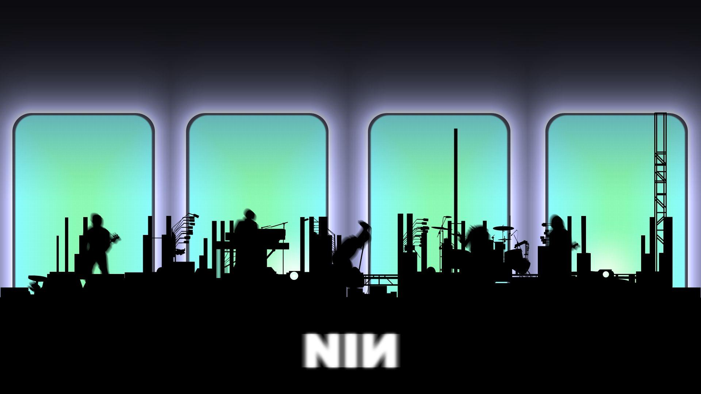

# Windows reinstall runbook



Snapshot from November 18, 2026. Restore the desktop and audio workflow in the order below. The inventory records [desktop apps](snapshot/inventory/desktop-apps.md), [Store packages](snapshot/inventory/store-packages.md), [plug-in files](snapshot/inventory/plugins.md) and [drivers](snapshot/inventory/drivers.md), with apps that come with Windows left out. Runtimes, SDKs and vendor helpers are still listed. The raw [WinGet list](snapshot/inventory/winget-list.txt) is unfiltered. Use them as a reference when deciding what to reinstall.

## Index

1. [Windows, motherboard, graphics and RGB](#1-windows-motherboard-graphics-and-rgb)
2. [Focusrite Scarlett Solo and DAWs](#2-focusrite-scarlett-solo-and-daws)
3. [Plug-ins and libraries](#3-plug-ins-and-libraries)
4. [Desktop workflow](#4-desktop-workflow): apps (Git, AutoHotkey, Vicinae, Flameshot, Tailscale, Claude, ChatGPT, GitHub Desktop, Herdr, Rex, File Pilot), wallpaper, power, hotkeys, virtual desktops, taskbar, Caps Lock

## 1. Windows, motherboard, graphics and RGB

1. Install the latest Windows 11 x64 updates. The native vertical taskbar setting may depend on the build.
2. Install the latest **AMD B650 chipset driver** and any missing Wi-Fi, LAN or Bluetooth drivers for the **MSI PRO B650M-A WIFI (MS-7D77)**. Select the exact motherboard and Windows version. [AMD B650 support](https://www.amd.com/en/support/downloads/drivers.html/chipsets/am5/b650.html) · [MSI board support](https://www.msi.com/Motherboard/PRO-B650M-A-WIFI/support)
3. Install the latest **AMD Radeon RX 570** Windows 11 driver from the exact GPU’s AMD page. The display was running at **3840×2160**. For the TV, the earlier setup used **Just Scan** to fix cropping. Adjust Windows display scaling to taste after restoring resolution. [AMD Radeon RX 570 downloads](https://www.amd.com/en/support/downloads/drivers.html/graphics/radeon-600-500-400/radeon-rx-500-series/radeon-rx-570.html)
4. Install the latest **Kingston FURY CTRL** for the two **Kingston KF560C36-16** DIMMs. `FURYController_Service` was **Running / Automatic**. Disable the FURY CTRL user app in **Settings → Apps → Startup**, while keeping its hardware service automatic. The actual RGB effect and color were not captured. [Kingston FURY CTRL](https://www.kingston.com/en/gaming/fury-ctrl)

## 2. Focusrite Scarlett Solo and DAWs

1. Reconnect the **Scarlett Solo USB** and confirm its hardware generation from the label or Focusrite account. Install the latest Windows package listed for that exact generation. Device Manager listed Scarlett Solo USB and Focusrite USB Audio, and the ASIO driver was registered. Use Focusrite Control 2 only if Focusrite lists it for the unit. [Focusrite downloads](https://downloads.focusrite.com/focusrite)
2. In Live’s Audio settings select **ASIO → Focusrite USB ASIO**. The latest Live log captured **44.1 kHz**, **256 samples** and **two inputs and two outputs**. Enable mono inputs 1/2 as needed and route Main to stereo **1/2**. Listen through headphones or speakers connected to the Solo. For guitar, use the instrument jack, enable INST and select the matching mono input (Input 2 in prior sessions). Record a short track and verify meter, playback and monitoring.
3. Install and authorize the latest release of **Ableton Live Suite** available under your license. Restore the packs and User Library, then point Live to them in Settings. The bundled `Preferences.cfg` and `Library.cfg` are references and same-version recovery copies. If restoring them, close Live and back up newly generated preferences first. Check paths and reselect the Scarlett after import. [Ableton account downloads](https://www.ableton.com/en/account/)
4. Reconnect the USB digital piano and **Akai MPK mini** if used. Enable the correct MIDI input and Track/Remote switches in Live. For the custom **RetryTake** control surface, restore `User Library\Remote Scripts\RetryTake`, select it in Live’s MIDI settings and test the saved button mapping on a disposable Arrangement take. The script was saved locally, and the earlier chat did not fully verify live recording after its last edit.
5. Install the latest ASIO4ALL only if needed for an alternate device routing workflow. The active Live setup used Focusrite USB ASIO for both input and output.

## 3. Plug-ins and libraries

Install the latest releases through vendor accounts or installers and restore libraries before opening older projects. Keep the same plug-in format the session originally used. Live’s standard system VST3 folder is `C:\Program Files\Common Files\VST3`. In Live **Settings → Plug-Ins**, enable the VST3 system folder and rescan. If a set used VST2, restore its matching plug-in and configure the custom VST2 folder. The two observed locations are `C:\Program Files\VstPlugins` and `C:\Program Files\Steinberg\VstPlugins`.

| Plug-in | What to restore |
| --- | --- |
| IK Multimedia TONEX | VST3 and standalone. Use IK Product Manager, restore the TONEX library and sign in for owned collections. |
| Steven Slate Drums 5 | SSDSampler5 VST3 and VST2. Install with Steven Slate Audio Center and restore kit content. User Library has **SSD Metal Starter - Dry and Tight**. |
| Ample Bass P | ABP VST3 and Ample Bass P VST2. Restore the associated sample library. |
| Celemony Melodyne 5 | VST3, plus the original license/edition. |
| Steinberg HALion Sonic | VST3. Reinstall and register content with Steinberg Library Manager. The earlier piano setup used **Acoustic Grand Piano**. |
| Steinberg Groove Agent SE | VST3, plus its libraries and any expansion content. |
| Splice | Live integration. Reconnect account and download user content if used. |
| Audio Assault Amp Locker | **Missing from scanned plug-in roots.** Live explicitly failed to restore it in `beat3.als`. Its installer was found at `Documents\Codex\2026-11-14\is-t\outputs\AmpLockerWin.exe`. Preserve or obtain the official installer, install VST3, restore `Public\Documents\Audio Assault\AmpLockerData` if needed and confirm the original project loads the instance. |
 
Open copies of important Live sets and older DAW sessions. Verify audio and samples, plug-in authorization, and preset recall. Save over originals only after verification. If the `beat3.als` mixer crash recurs, preserve the original and verify on a separate copy. The [plug-in list](snapshot/inventory/plugins.md) is a file inventory from standard and known application-specific paths. It cannot identify unavailable drives, lost downloads, purchase entitlements or plug-ins in unknown folders.

## 4. Desktop workflow

Install the latest releases from WinGet or the vendor. The installed-app inventory is under `snapshot/inventory`.

```powershell
winget install --id Git.Git --exact
winget install --id AutoHotkey.AutoHotkey --exact
winget install --id Vicinae.Vicinae --exact
winget install --id Flameshot.Flameshot --exact
winget install --id Tailscale.Tailscale --exact
winget install --id Anthropic.Claude --exact
winget install --id OpenAI.ChatGPT --exact
winget install --id GitHub.GitHubDesktop --exact
```

```powershell
# Herdr Desktop (per-user, no admin); also installs herdr-core if missing
powershell -c "irm https://releases.herdr.dev/app/install.ps1 | iex"
```

- **File Pilot.** Run the latest all-in-one installer from the vendor and enable its default file manager or folder-opening integration. Verify folder and drive shell opens and the per-user executable location `%LOCALAPPDATA%\Voidstar\FilePilot\FPilot.exe`. WinGet may install the portable edition, which alone does not enable the installer’s integration. The current setup routes ordinary folders and drives. Apps invoking Explorer directly may still open Explorer. [File Pilot download and integration](https://filepilot.tech/download)
- **Vicinae.** Restore the supplied settings file to `%LOCALAPPDATA%\vicinae\config\settings.json`. The setting `global_shortcuts.toggle = "super+d"` gives **Win+D** to Vicinae in place of Show Desktop. Create a user Startup shortcut named **Vicinae** to `%LOCALAPPDATA%\Programs\Vicinae\bin\vicinae-server.exe` if the installer didn’t. The Linux reference is [alexeightsix/nixstart](https://github.com/alexeightsix/nixstart).
- **Flameshot.** Restore the INI to `%APPDATA%\flameshot\flameshot.ini`. The global shortcut is **Ctrl+;**. Add a Startup shortcut to `C:\Program Files\Flameshot\bin\flameshot.exe` with no arguments. A resident instance owns capture and copy. Test Ctrl+; → select visible text → Copy → paste in Paint. The old AutoHotkey invocation of `flameshot gui` was removed after the Windows clipboard problem. [Flameshot issue #4118](https://github.com/flameshot-org/flameshot/issues/4118)
- **AutoHotkey.** Put `NativeDesktops.ahk` and `VirtualDesktopAccessor.dll` next to each other in `%LOCALAPPDATA%\NativeDesktopHotkeys`. Use AutoHotkey **v2 x64**, with a single user Startup shortcut named **Native Desktop Hotkeys**, passing the quoted absolute path to the script. Startup folder is `shell:startup`. The bundled DLL is from the source machine. If its API does not work on the new Windows build, fetch a compatible x64 release and retest. [VirtualDesktopAccessor releases](https://github.com/Ciantic/VirtualDesktopAccessor/releases)
- **Hotkeys.** Bare Win is masked so it does not open Start. The Start button is still accessible. **Space, F, F** and **hold Win, tap F twice within 650 ms** open File Pilot. The Space sequence consumes typed trigger text. Single Win+F is intercepted so Feedback Hub does not launch. The older Win+E remap was retired. Test File Pilot both when already open and when starting on another virtual desktop.
- **Virtual desktops.** Create ten desktops in Task View. Win+1…9 switches to desktops 1…9, and Win+0 to desktop 10. Automatic routing is Live → 1, TONEX → 2, Chrome → 3, ChatGPT → 4, and Settings, Sound, Focusrite Control and Bluetooth transfer → 10. Keep the full script for executable names. Use **Settings → System → Multitasking → Desktops** to show open apps on the taskbar from **all desktops**.
- **Taskbar.** Use **Settings → Personalization → Taskbar → Taskbar behaviors → Taskbar position → Left** for a vertical bar. Search was hidden, Task View on, Widgets and Resume off. [Microsoft taskbar instructions](https://support.microsoft.com/en-us/windows/experience/personalization/customize-the-taskbar-in-windows)
- **Claude Desktop and ChatGPT Desktop.** Both were installed through WinGet: Claude **6.28899.6** (`Anthropic.Claude`) and ChatGPT **26.1111.2228.0** (`OpenAI.ChatGPT`). Sign in to each after installing. ChatGPT is routed to virtual desktop 4 (see below). Claude Code sessions use the Claude Desktop Code tab.
- **GitHub Desktop.** Installed November 27, 2026 (`GitHub.GitHubDesktop`, 3.7.1). Sign in, then **File → Clone repository** to bring this runbook back as `kickstart-windows`.
- **Rex (Superlogical).** Installed as **0.1.1-preview.41**, per-user in `%LOCALAPPDATA%\Superlogical\Rex`. The Windows app is in beta and only available to enrolled testers; enrollment instructions are on Superlogical's Discord. Download the latest preview installer, [latest.exe](https://blob.superlogical.com/download/rex-win32/preview/latest.exe), from the [Rex installation docs](https://www.superlogical.com/rex/docs/installation). It needs Windows 10 1809 or newer. It isn't on WinGet. For the server only, see [Rex Server for Windows](https://www.superlogical.com/rex/docs/windows/installation).
- **Wallpaper.** Restore [snapshot/desktop/wallpaper.jpg](snapshot/desktop/wallpaper.jpg) (the Nine Inch Nails image, originally set through the Photos app). Copy it somewhere permanent, such as `%USERPROFILE%\Pictures\wallpaper.jpg`, then right-click it → **Set as desktop background** or use **Settings → Personalization → Background → Picture**. The fit was **Fill** (`WallpaperStyle` 10, `TileWallpaper` 0).
- **Power.** The active plan was **High performance** (no battery). Settings were: display off after **10 min**, sleep after **30 min**, hibernate **never**, hybrid sleep **on**, wake timers **enabled**, hard disk off after **20 min**, minimum processor state **0%**, maximum **100%**, PCIe link state power management **off**, fast startup **on**. To reapply from an admin terminal:

  ```powershell
  powercfg /setactive 8c5e7fda-e8bf-4a96-9a85-a6e23a8c635c   # High performance
  powercfg /change monitor-timeout-ac 10
  powercfg /change standby-timeout-ac 30
  powercfg /change hibernate-timeout-ac 0
  powercfg /change disk-timeout-ac 20
  ```

  If High performance is missing on a fresh install, create it with `powercfg /duplicatescheme 8c5e7fda-e8bf-4a96-9a85-a6e23a8c635c` and activate the GUID it prints. Power-button action and USB selective suspend couldn't be read without admin, so check them in **Control Panel → Power Options → Change advanced power settings**.
- **Caps Lock → Escape.** The live HKLM Scancode Map was `00000000000000000200000001003A0000000000`. Use the included earlier PowerShell script with admin access after saving work. It merges an existing keyboard map and restarts immediately. Review differences first if the destination uses other remaps.
- **Herdr Desktop.** Added November 27, 2026, after this snapshot. It runs coding agents (Claude Code, Codex) in persistent terminals. Install with the official script above. It verifies the download's SHA-256, installs the app to `%LOCALAPPDATA%\Programs\herdr-app` (on PATH as `herdr-app`) with a **Herdr** Start menu entry, and installs herdr-core (`hc`) to `%LOCALAPPDATA%\Programs\herdr-core` if it is missing. Versions installed were app **0.1.18** and `hc` **0.1.22**. Windows support is beta and the binary is unsigned, so SmartScreen may warn on first launch (**More info → Run anyway**). Re-run the script to update. The WinGet package `Herdr.Herdr` is the separate terminal (TUI) edition. Don't use the third-party `hdosys.*` or `khanhtd36.*` packages. [Herdr download](https://herdr.dev/download/) · [Windows beta notes](https://herdr.dev/docs/preview/windows-beta/)
- **Tailscale.** Added November 27, 2026, after this snapshot. Install with WinGet above (MSI from `pkgs.tailscale.com`, version **1.104.7** at the time). The `Tailscale` service should be **Running / Automatic**. Sign in from the tray icon or with `tailscale up`, then confirm this PC appears in the admin console with its expected name. [Tailscale download](https://tailscale.com/download)
